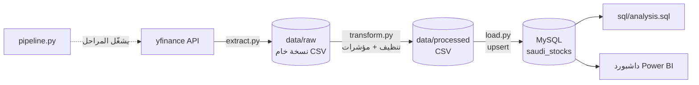
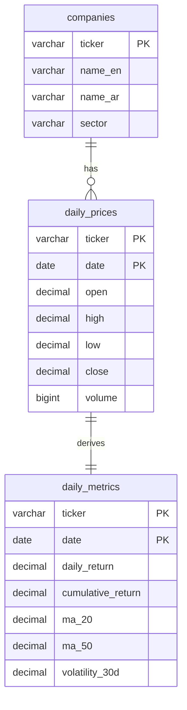
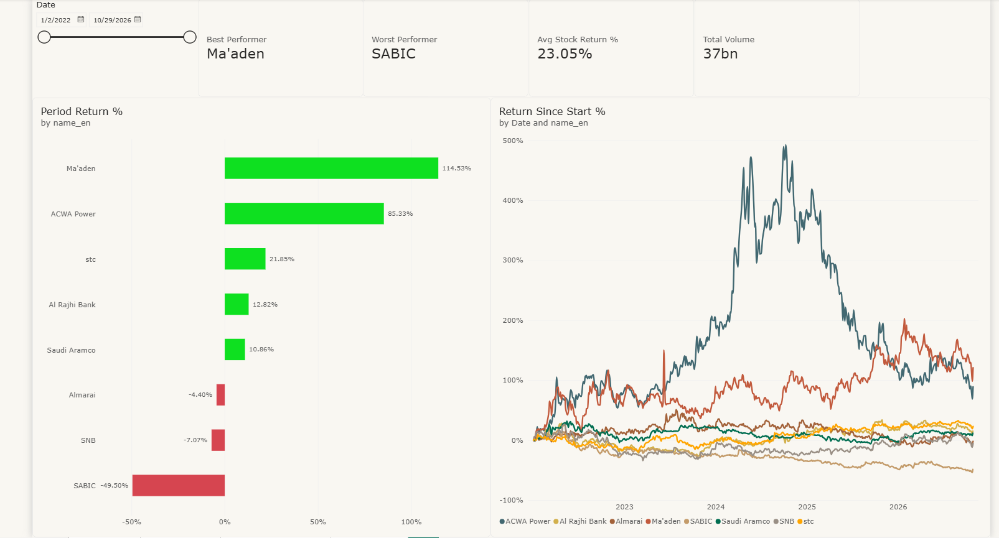
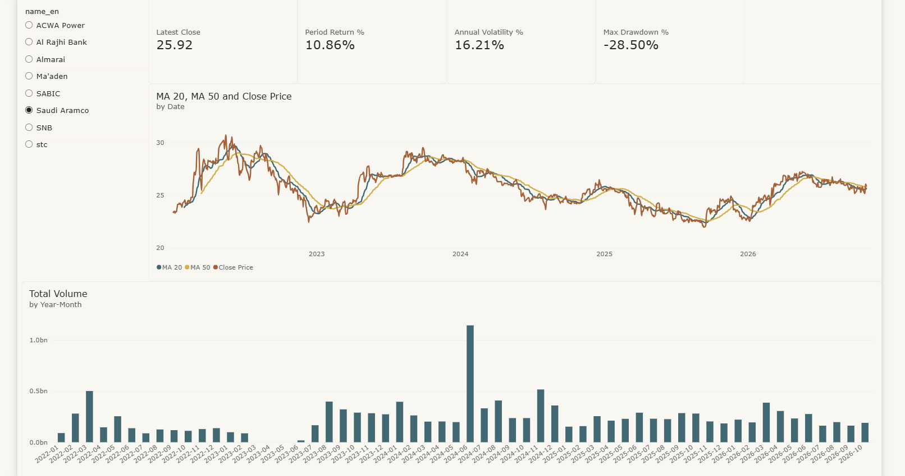
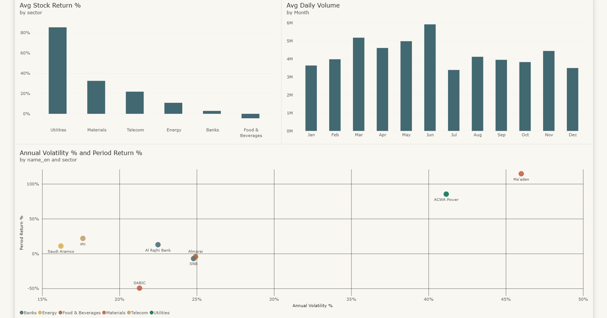
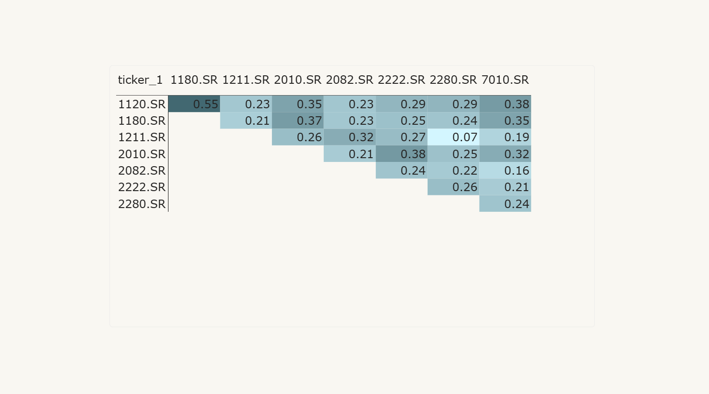

# مسار بيانات الأسهم السعودية (ETL)

[English](README.md) | **العربية**

مسار بيانات متكامل يسحب الأسعار اليومية من يناير 2022 لثماني شركات كبيرة في السوق السعودية (تداول)، وينظفها ويحسب مؤشرات العائد والمخاطرة باستخدام Pandas، ثم يخزنها في MySQL ويعرضها في داشبورد Power BI.

## الأسئلة اللي يجاوب عليها المشروع

1. أي سهم حقق أعلى عائد تراكمي خلال الفترة؟
2. أي الأسهم أكثر تذبذباً (مخاطرة)؟
3. كيف أداء القطاعات مقارنة ببعض؟
4. هل فيه أشهر أو فترات يرتفع فيها حجم التداول بشكل واضح؟
5. كيف علاقة الأسهم ببعض (الارتباط)؟

## مسار البيانات



| المرحلة | وش تسوي |
|---------|----------|
| **Extract (السحب)** | تسحب الأسعار اليومية (افتتاح، أعلى، أدنى، إغلاق، حجم) لكل سهم، وتحفظ نسخة خام بدون تعديل في `data/raw`. لو فشل سهم تسجّل الخطأ وتكمل الباقي. السحب **تزايدي**: تجيب بس الأيام اللي بعد آخر تاريخ مخزن في MySQL. |
| **Transform (التحويل)** | تحذف التكرار، والصفوف اللي أسعارها ناقصة، والأيام الوهمية اللي حجمها صفر. تخلي الحجم NULL إذا كان صغير بشكل غير منطقي، وتشيل المنطقة الزمنية من التواريخ، وتحسب `daily_return` و`cumulative_return` و`ma_20` و`ma_50` و`volatility_30d`. |
| **Load (التحميل)** | تنشئ القاعدة والجداول إذا ما كانت موجودة، وتدخل البيانات بـ `INSERT ... ON DUPLICATE KEY UPDATE`، فإعادة التشغيل ما تكرر الصفوف أبداً. |

### تفاصيل التحميل التزايدي

- في كل تشغيل، يعيد سحب آخر يوم مخزن ويقارنه بسعر الإغلاق المحفوظ. الأسعار معدلة بالتوزيعات، فأي توزيع جديد يغيّر كل التاريخ القديم. إذا اختلف السعر بأكثر من 0.1%، يعيد تحميل السهم كامل (يحذف القديم ويدخل الجديد في عملية وحدة).
- المؤشرات المتحركة تحتاج أيام قبل الأيام الجديدة، فالتشغيل التزايدي يقرأ أسعار السهم المخزنة من MySQL ويحسب المؤشرات على السلسلة كاملة.
- سعر اليوم الحالي ما ينسحب إلا بعد إغلاق السوق.

### تعديل الأسعار والفترة

- **الأسعار معدلة بالتوزيعات وأسهم المنحة.** yfinance ينادى بـ `auto_adjust=True` (الإعداد `AUTO_ADJUST` في `config.py`)، فعمود `Close` هو سعر الإغلاق المعدل، وما فيه عمود `Adj Close` منفصل. مثال: الراجحي يوم 2 نوفمبر 2021 مخزن 52.37 (معدل)، وسعر التداول الفعلي كان 59.00. يعني العوائد تشمل التوزيعات.
- **بداية الفترة ثابتة.** البيانات تبدأ من `START_DATE` (2022-01-01، وأول يوم تداول 2 يناير 2022) وتنتهي بآخر يوم تداول متاح. الأسهم الثمانية كلها عندها بيانات من 19 ديسمبر 2021، فكل الأسهم تغطي نفس الفترة. وإعادة التحميل بـ `--full` ترجّع نفس البيانات بدل ما تحرّك تاريخ البداية.

## الأسهم

| الرمز | الشركة | القطاع |
|-------|--------|--------|
| 2222.SR | أرامكو السعودية | الطاقة |
| 1120.SR | مصرف الراجحي | البنوك |
| 1180.SR | البنك الأهلي السعودي | البنوك |
| 2010.SR | سابك | المواد الأساسية |
| 1211.SR | معادن | المواد الأساسية |
| 7010.SR | إس تي سي | الاتصالات |
| 2280.SR | المراعي | الأغذية والمشروبات |
| 2082.SR | أكوا باور | المرافق العامة |

## هيكل قاعدة البيانات



## التقنيات المستخدمة

| الأداة | ليش |
|--------|-----|
| **Python 3.14** | اللغة اللي تربط المسار كله. |
| **yfinance** | وصول مجاني لأسعار تداول اليومية (رموز `.SR`) مع أسعار معدلة بالتوزيعات. |
| **Pandas** | التنظيف وحساب المؤشرات المتحركة بسرعة. |
| **SQLAlchemy + PyMySQL** | إدارة الاتصال بالقاعدة واستعلامات بمعاملات (parameterized). مكتبة PyMySQL مكتوبة بـ Python بالكامل، فما تحتاج تثبيت compiler على Windows. |
| **python-dotenv** | يخلي بيانات الاتصال في ملف `.env` محلي، بعيد عن الكود وعن Git. |
| **MySQL 8** | تخزين علائقي يدعم دوال النوافذ (window functions) لاستعلامات التحليل، وله موصل مباشر في Power BI. |
| **Power BI** | داشبورد تفاعلي فوق MySQL. |
| **logging** | سجل تشغيل بالوقت في `logs/pipeline.log` بدل `print`. |

## هيكل المشروع

```
saudi-stocks-etl/
├── config.py          # الأسهم، القطاعات، الفترة، نوافذ المؤشرات
├── extract.py         # السحب من yfinance + نسخة خام CSV
├── transform.py       # التنظيف + المؤشرات
├── load.py            # إنشاء الجداول + الإدخال في MySQL
├── pipeline.py        # يشغّل السحب ← التحويل ← التحميل
├── check_tickers.py   # فحص لمرة وحدة إن كل رمز يرجع بيانات
├── sql/
│   ├── schema.sql     # القاعدة والجداول
│   └── analysis.sql   # استعلامات تجاوب على الأسئلة الخمسة
├── data/raw/          # النسخ الخام (مستبعدة من Git)
├── data/processed/    # البيانات المنظفة (مستبعدة من Git)
├── logs/              # pipeline.log (مستبعد من Git)
└── powerbi/           # ملف الداشبورد .pbix + دليل البناء
```

## طريقة التشغيل

1. **انسخ المشروع وسوّ بيئة افتراضية**
   ```bash
   git clone https://github.com/Muhanad76/saudi-stocks-etl.git
   cd saudi-stocks-etl
   python -m venv .venv
   .venv\Scripts\activate
   pip install -r requirements.txt
   ```
2. **بيانات الاتصال بـ MySQL**: انسخ `.env.example` باسم `.env` واكتب اسم المستخدم وكلمة السر. القاعدة والجداول تنشأ تلقائياً.
3. **(اختياري) افحص الرموز**
   ```bash
   python check_tickers.py
   ```
4. **شغّل المسار**
   ```bash
   python pipeline.py              # أول مرة = تحميل كامل من START_DATE، بعدها = تزايدي
   python pipeline.py --full       # إعادة تحميل كامل إجباري
   python pipeline.py --skip-load  # سحب + تحويل بس (بدون قاعدة بيانات)
   ```
5. **شغّل التحليل**: افتح `sql/analysis.sql` في MySQL Workbench وشغّل كل استعلام.
6. **افتح الداشبورد**: مجلد `powerbi/`. طريقة بنائه في `powerbi/GUIDE.md`.

## أهم النتائج

الأرقام حتى **29 أكتوبر 2026**، وتغطي الفترة من 2 يناير 2022 إلى 29 أكتوبر 2026 (نفس الفترة لكل الأسهم). كل الأرقام من `sql/analysis.sql` بعد تشغيله على القاعدة. الأسعار معدلة بالتوزيعات، فالعوائد تشمل التوزيعات.

| السهم | القطاع | العائد الكلي | التذبذب السنوي | أكبر نزول |
|-------|--------|-------------:|---------------:|----------:|
| معادن | المواد الأساسية | +114.5% | 46.0% | -45.7% |
| أكوا باور | المرافق العامة | +85.3% | 41.1% | -71.6% |
| إس تي سي | الاتصالات | +21.9% | 17.6% | -26.5% |
| مصرف الراجحي | البنوك | +12.8% | 22.5% | -42.8% |
| أرامكو السعودية | الطاقة | +10.9% | 16.2% | -28.5% |
| المراعي | الأغذية والمشروبات | -4.4% | 24.9% | -41.2% |
| البنك الأهلي | البنوك | -7.1% | 24.8% | -47.9% |
| سابك | المواد الأساسية | -49.5% | 21.3% | -61.3% |
| **المتوسط** | | **+23.1%** | | |

- **الأعلى عائداً: معادن (+115%)**، وبعدها أكوا باور (+85%). باقي الأسهم كلها أقل من 25%، وثلاثة منها خسرت. سابك الأضعف بـ **-50%**، وعائدها سالب في كل سنة من 2022 إلى 2026.
- **العائد العالي جاء مع مخاطرة عالية.** معادن (تذبذب سنوي 46%) وأكوا باور (41%) أكثر من ضعف تذبذب أرامكو (16%) وstc (18%). أكوا باور ارتفعت 80% ثم 70% ثم 57% من 2022 إلى 2024، وبعدها نزلت 55% في 2025. أكبر نزول لها من القمة كان **-72%**.
- **القطاعات:** المرافق العامة (+85%) والمواد الأساسية (+33% كمتوسط) في المقدمة. لكن متوسط المواد الأساسية يخفي فرق كبير (معادن +115% مقابل سابك -50%). البنوك (+3%) والأغذية والمشروبات (-4%) في المؤخرة. الاتصالات أعطت أفضل عائد مقابل المخاطرة بعد المرافق، والطاقة أقل القطاعات تذبذباً.
- **مواسم التداول:** من مارس إلى يونيو التداول أعلى بوضوح من المستوى الطبيعي لكل سهم. مايو أنشط شهر (+33%)، وبعده مارس (+27%). ديسمبر (-20%) ويوليو (-16%) أهدأ شهرين، وهذا يتوافق مع نهاية السنة والإجازة الصيفية.
- **الارتباط:** العوائد اليومية مرتبطة ببعض بشكل ضعيف (متوسط الارتباط بين كل زوج 0.27). أقوى ارتباط بين البنكين، الراجحي والأهلي (0.55). معادن والمراعي شبه ما بينهم ارتباط (0.07). هذا التنوع في القطاعات يوزع المخاطرة بشكل جيد.

## الداشبورد

مبني في Power BI Desktop باتصال Import على قاعدة `saudi_stocks`. مقاييس DAX وتصميم الصفحات موثقة في [`powerbi/GUIDE.md`](powerbi/GUIDE.md)، وملف التقرير `powerbi/saudi_stocks_dashboard.pbix`.

**نظرة عامة**: الأفضل والأسوأ أداءً، متوسط العائد، إجمالي الحجم، العائد لكل سهم، ورسم خطي يقارن العوائد من نقطة بداية وحدة.



**تفاصيل سهم**: مؤشرات السهم (آخر إغلاق، العائد، التذبذب، أكبر نزول)، سعر الإغلاق مع المتوسطين المتحركين 20 و50 يوم، وحجم التداول الشهري.



**مقارنة القطاعات**: متوسط العائد لكل قطاع، متوسط الحجم اليومي حسب الشهر، ورسم يوضح العائد مقابل المخاطرة.



**الارتباط**: مصفوفة الارتباط بين عوائد كل زوج من الأسهم. ما تنحسب بـ DAX، بل الصفحة تستورد الاستعلام **Q7** من `sql/analysis.sql` كـ SQL statement (Get Data > MySQL > Advanced options).



مقياس مهم: `Return Since Start %` يخلي كل الأسهم تبدأ من 0% في بداية الفترة المختارة. وفي الأيام اللي ما فيها سعر للسهم يرجع فاضي بدل -100%:

```DAX
Return Since Start % =
VAR _FirstDate =
    CALCULATE ( MIN ( daily_prices[date] ), ALLSELECTED ( 'Date' ) )
VAR _FirstClose =
    CALCULATE ( AVERAGE ( daily_prices[close] ), ALLSELECTED ( 'Date' ), daily_prices[date] = _FirstDate )
VAR _Close = AVERAGE ( daily_prices[close] )
RETURN IF ( NOT ISBLANK ( _Close ), DIVIDE ( _Close, _FirstClose ) - 1 )
```

## القيود

- **مكتبة yfinance غير رسمية.** تسحب من Yahoo Finance، وممكن يتغير بدون إنذار. البيانات ممكن تتأخر أو تتعدل أو تنقص أحياناً. مثلاً آخر يوم أحياناً يوصل فيه الحجم بدون الأسعار، فينحذف ويتسحب في تشغيل لاحق.
- **بيانات حجم خاطئة من مارس إلى يونيو 2023.** في 7 من 8 أسهم (كلها ما عدا stc)، Yahoo يعطي أحجام أصغر من الحقيقية بحوالي ألف مرة بين 1 مارس و18 يونيو 2023، والأسعار صحيحة. المسار يخزن الحجم NULL في أي يوم أقل من 5% من وسيط حجم السهم على كامل الفترة (58 إلى 68 يوم لكل سهم، كلها داخل هذي الفترة). العوائد والتذبذب والارتباط ما تأثرت. متوسطات الحجم تتجاهل هذي الأيام، لكن *مجموع* الحجم لهذي الشهور أقل من الحقيقي. Power BI يخفي الشهور اللي ما فيها بيانات افتراضياً، ففعّل "Show items with no data" على محور الشهور عشان تبان الفجوة.
  - **استثناء معروف:** أكوا باور يوم 8 مارس 2023 حجمه 27,312 سهم، يعني 9.2% من الوسيط. غالباً بيانات خاطئة بعد، لكنه فوق الحد فانحفظ. رفع الحد لـ 10% يكشفه، لكنه يكشف معه 9 أيام هادية عادية برا الفترة الخاطئة.
- Yahoo يرجّع **أيام وهمية حجمها صفر** (كل الأسعار متساوية والحجم 0) للأسهم السعودية: حوالي 30 إلى 50 يوم لكل سهم من 2022. هذي تنحذف بدل ما تتعبى، فممكن تنقص بعض أيام التداول الحقيقية.
- مؤشر تاسي (`^TASI.SR`) يرجع آخر يوم بس في yfinance، فما انضاف كمرجع للسوق.
- التذبذب هو الانحراف المعياري التاريخي، وهو مقياس بسيط للمخاطرة. مو توقع، ومو نصيحة استثمارية.
