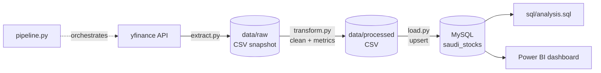
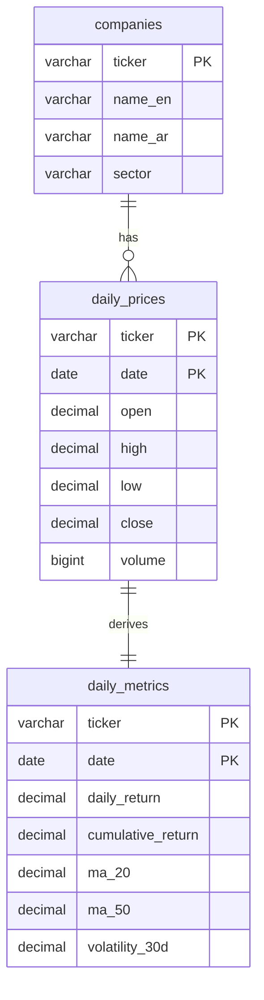

# Saudi Stocks ETL Pipeline

**English** | [العربية](README.ar.md)

An end-to-end data pipeline that extracts five years of daily prices for eight
large Saudi Exchange (Tadawul) companies, cleans them and computes return and
risk metrics with Pandas, loads them into MySQL, and serves them to a Power BI
dashboard.

## Questions this project answers

1. Which stock delivered the highest cumulative return over the period?
2. Which stocks are the most volatile (riskiest)?
3. How do sectors compare with each other?
4. Are there months or periods with clearly higher trading volume?
5. How correlated are the stocks with each other?

## Pipeline



| Stage | What it does |
|-------|--------------|
| **Extract** | Downloads daily OHLCV bars per ticker, saves an untouched CSV copy to `data/raw`, logs and skips any ticker that fails. Runs **incrementally**: only days after the last date stored in MySQL are fetched. |
| **Transform** | Removes duplicates, rows with missing prices and zero-volume placeholder days; sets implausibly low volumes to NULL; converts dates to timezone-naive trading dates; computes `daily_return`, `cumulative_return`, `ma_20`, `ma_50`, `volatility_30d`. |
| **Load** | Creates the schema if needed and upserts with `INSERT ... ON DUPLICATE KEY UPDATE`, so re-running never duplicates rows. |

### Incremental loading details

- On each run the last stored day is re-downloaded and compared with the stored
  close. Prices are dividend-adjusted, so a new dividend rewrites the whole
  history; if the close differs by more than 0.1% the ticker is reloaded in full
  (old rows deleted, then re-inserted in one transaction).
- Rolling metrics need history before the new days, so incremental runs read
  the ticker's stored prices from MySQL and compute metrics over the full series.
- A daily bar for the current day is skipped until the market has closed.

## Stocks covered

| Ticker | Company | Sector |
|--------|---------|--------|
| 2222.SR | Saudi Aramco | Energy |
| 1120.SR | Al Rajhi Bank | Banks |
| 1180.SR | SNB | Banks |
| 2010.SR | SABIC | Materials |
| 1211.SR | Ma'aden | Materials |
| 7010.SR | stc | Telecom |
| 2280.SR | Almarai | Food & Beverages |
| 2082.SR | ACWA Power | Utilities |

## Database schema



## Tech stack

| Tool | Why |
|------|-----|
| **Python 3.14** | Glue language for the whole pipeline. |
| **yfinance** | Free access to Tadawul daily prices (`.SR` tickers) with dividend-adjusted closes. |
| **Pandas** | Cleaning and vectorised rolling-window metrics. |
| **SQLAlchemy + PyMySQL** | Database-agnostic connection handling and parameterized queries; PyMySQL is pure Python, so no compiler is needed on Windows. |
| **python-dotenv** | Keeps database credentials in a local `.env` file, out of the code and out of Git. |
| **MySQL 8** | Relational storage with window functions for the analysis SQL; native Power BI connector. |
| **Power BI** | Interactive dashboard on top of MySQL. |
| **logging** | Timestamped run history in `logs/pipeline.log` instead of `print`. |

## Project structure

```
saudi-stocks-etl/
├── config.py          # tickers, sectors, period, metric windows
├── extract.py         # yfinance download + raw CSV snapshot
├── transform.py       # cleaning + metrics
├── load.py            # schema creation + MySQL upserts
├── pipeline.py        # runs extract -> transform -> load
├── check_tickers.py   # one-off check that every ticker returns data
├── sql/
│   ├── schema.sql     # database and tables
│   └── analysis.sql   # queries answering the five questions
├── data/raw/          # raw snapshots (git-ignored)
├── data/processed/    # cleaned output (git-ignored)
├── logs/              # pipeline.log (git-ignored)
└── powerbi/           # dashboard .pbix + build guide
```

## How to run

1. **Clone and create a virtual environment**
   ```bash
   git clone https://github.com/Muhanad76/saudi-stocks-etl.git
   cd saudi-stocks-etl
   python -m venv .venv
   .venv\Scripts\activate          # Windows
   pip install -r requirements.txt
   ```
2. **Configure MySQL credentials**: copy `.env.example` to `.env` and fill in
   your user and password. The database and tables are created automatically.
3. **(Optional) check the tickers**
   ```bash
   python check_tickers.py
   ```
4. **Run the pipeline**
   ```bash
   python pipeline.py              # first run = full 5-year load, later runs = incremental
   python pipeline.py --full       # force a full reload
   python pipeline.py --skip-load  # extract + transform only (no database)
   ```
5. **Run the analysis**: open `sql/analysis.sql` in MySQL Workbench and run
   each query.
6. **Open the dashboard**: `powerbi/` (see `powerbi/GUIDE.md` for how it is built).

## Key insights

Data window: 19 Dec 2021 to 28 Oct 2026 (the common window where all eight
stocks have data). Prices are dividend-adjusted, so returns include dividends.
All figures come from `sql/analysis.sql` run against the loaded database.

- **Best performer: Ma'aden (+130%)**, followed by ACWA Power (+101%). Every
  other stock returned less than 25%, and three lost money. SABIC was the
  weakest at **-48%** and had a negative return in every calendar year from
  2022 to 2026.
- **Risk comes with the return.** Ma'aden (46% annualised volatility) and ACWA
  Power (41%) are more than twice as volatile as Aramco (16%) and stc (18%).
  ACWA Power rose 82%, 70% and 57% in 2022 to 2024, then fell 55% in 2025. Its
  maximum drawdown was **-72%**.
- **Sectors:** Utilities (+101%) and Materials (+41% on average) led, but the
  Materials average hides a wide spread (Ma'aden +130% vs SABIC -48%). Banks
  (+8%) and Food & Beverages (-2%) lagged. Telecom gave the best return per
  unit of risk after Utilities, with Energy the least volatile sector.
- **Volume seasonality:** March to June trade well above each stock's normal
  level. May is the busiest month (+32%), followed by March (+26%). July is the
  quietest (-16%), which fits the summer holiday period.
- **Correlation:** daily returns are only loosely related (average pairwise
  correlation 0.27). The strongest pair is the two banks, Al Rajhi and SNB
  (0.55). Ma'aden and Almarai are almost uncorrelated (0.07). This mix of
  sectors spreads risk well.

## Dashboard

Built in Power BI Desktop on an Import connection to the `saudi_stocks`
database. The DAX measures and page layout are documented in
[`powerbi/GUIDE.md`](powerbi/GUIDE.md); the report file is
`powerbi/saudi_stocks_dashboard.pbix`.

**Overview**: best/worst performer, average return, total volume, return by
stock and a rebased return line chart.


**Stock detail**: single-stock KPIs (latest close, return, volatility, max
drawdown), close price with 20/50-day moving averages, and monthly volume.


**Sector comparison**: average return by sector, average daily volume by
calendar month, and a risk-vs-return scatter.


**Correlation**: a matrix of pairwise daily-return correlations. It is not
computed in DAX: the page imports query **Q7** from `sql/analysis.sql` as a
SQL statement (Get Data > MySQL > Advanced options).


Notable measure: `Return Since Start %` rebases every stock to 0% at the start
of the selected period. It returns blank on days a stock has no price, rather
than -100%:

```DAX
Return Since Start % =
VAR _FirstDate =
    CALCULATE ( MIN ( daily_prices[date] ), ALLSELECTED ( 'Date' ) )
VAR _FirstClose =
    CALCULATE ( AVERAGE ( daily_prices[close] ), ALLSELECTED ( 'Date' ), daily_prices[date] = _FirstDate )
VAR _Close = AVERAGE ( daily_prices[close] )
RETURN IF ( NOT ISBLANK ( _Close ), DIVIDE ( _Close, _FirstClose ) - 1 )
```

## Limitations

- **yfinance is unofficial.** It scrapes Yahoo Finance, which can change
  without notice. Data may be delayed, revised or occasionally missing. For
  example, the latest day sometimes arrives with volume but no prices; it is
  dropped and picked up on a later run.
- **Bad volume data, Mar to Jun 2023.** For 7 of the 8 stocks (all except stc),
  Yahoo reports volumes about 1000x too small between 1 Mar and 18 Jun 2023,
  while prices are correct. The pipeline stores volume as `NULL` on any day
  below 2% of that stock's full-period median volume (58 to 68 days per stock,
  all inside that window). Returns, volatility and correlation are unaffected.
  Volume averages skip these days, but monthly *totals* for those months are
  understated.
- Yahoo returns some **zero-volume placeholder days** (all prices equal, volume
  0) for Saudi tickers: about 30 to 50 per stock over five years. These are
  dropped instead of filled, so a few real trading days may be missing.
- **ACWA Power data starts on 19 Dec 2021**, so its history is slightly shorter
  than five years. Cross-stock comparisons use the common window.
- The TASI index (`^TASI.SR`) only returns the latest day in yfinance, so the
  market benchmark is not included.
- Volatility is historical standard deviation, which is a simple risk measure.
  It is not a forecast and not investment advice.
